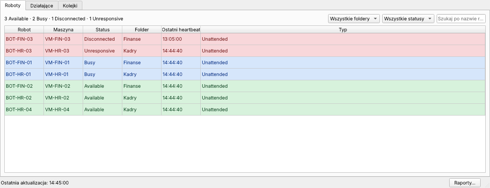
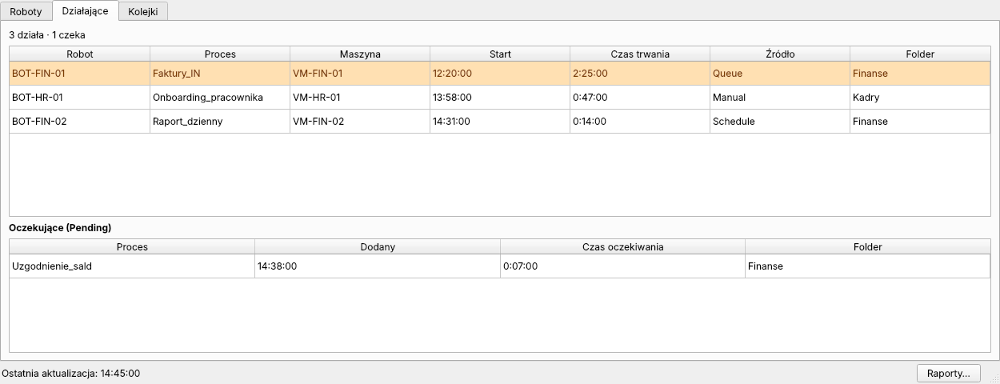
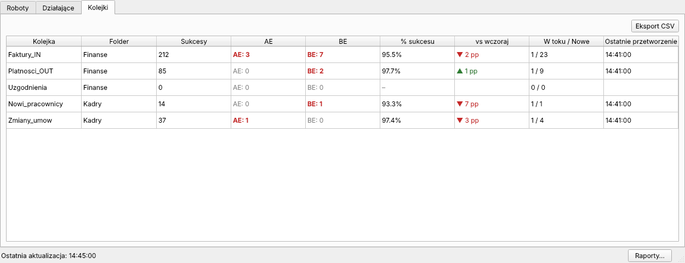
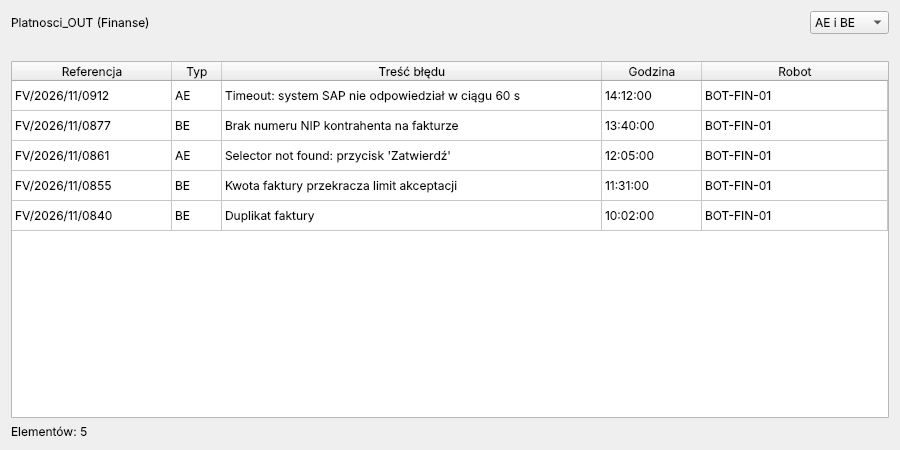
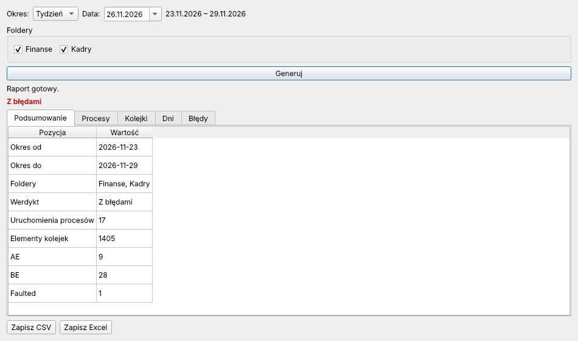
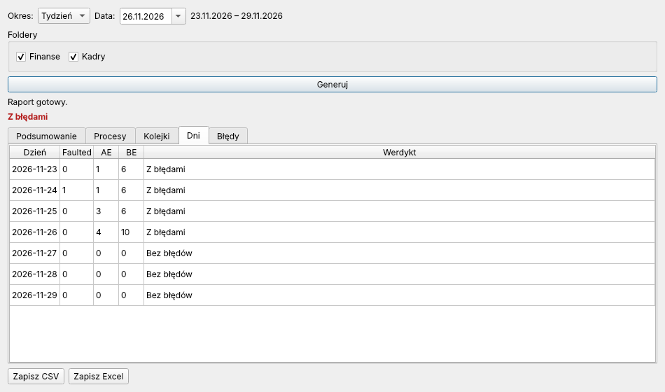
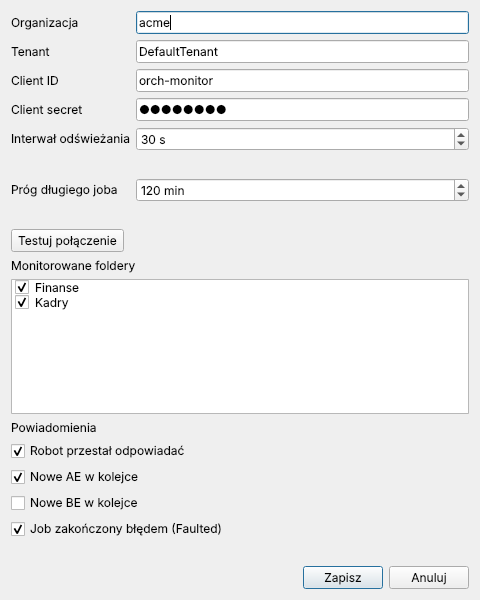

# Orchestrator Monitor

Desktopowa aplikacja dla Windows (Python + PySide6) do **tylko odczytu** monitorowania UiPath Orchestratora
(Automation Cloud, wersja 24). Pokazuje stan robotów, działające joby i kolejki, wysyła powiadomienia na pulpit
i generuje raporty. Aplikacja niczego nie uruchamia, nie zatrzymuje i nie zmienia w Orchestratorze.

## Co potrafi

- **Roboty**: statusy robotów z sesji, sortowanie i wyszukiwanie.
- **Działające**: joby w toku (z oznaczeniem długiego działania), oczekujące (Pending) i zakończone błędem (Faulted).
- **Kolejki**: dzisiejsze sukcesy, AE i BE, procent sukcesu, zmiana względem wczoraj; podgląd elementów z błędami
  i eksport do CSV.
- **Powiadomienia** na pulpit: robot przestał odpowiadać, nowe AE/BE w kolejce, job Faulted. Można je wyciszyć
  na 30 min, 1 h, 4 h lub do końca dnia (zasobnik > „Wycisz powiadomienia”). Wyciszenie działa tylko w bieżącej
  sesji aplikacji.
- **Raporty** za dzień, tydzień, miesiąc lub dowolny zakres: podsumowanie, procesy, kolejki, dni i błędy.
  Eksport jako ZIP z 5 plikami CSV (UTF-8, separator `;`) lub jako Excel (5 arkuszy).

Dane odświeżają się co ok. 30 s (interwał można zmienić w ustawieniach).

## Wymagania

- Windows 10/11. Gotowy `OrchMonitor.exe` nie wymaga instalacji Pythona.
- Do uruchomienia ze źródeł: Python 3.12 lub nowszy (lokalnie używany 3.13).
- Tenant Orchestratora w Automation Cloud i konto External Application z dostępem do odczytu.

## Konfiguracja w Orchestratorze

Aplikację zakłada administrator organizacji w **Admin > External Applications**:

1. Dodaj aplikację typu **Confidential Application**.
2. Zaznacz zakresy tylko do odczytu:
   `OR.Robots.Read`, `OR.Jobs.Read`, `OR.Queues.Read`, `OR.Folders.Read`, `OR.Execution.Read`.
3. Zapisz **Client ID** i **Client Secret**. Sekret podaj tylko w aplikacji.
4. Upewnij się, że aplikacja ma dostęp do folderów, które chcesz monitorować.

## Pierwsze uruchomienie

1. Uruchom `OrchMonitor.exe`. Pojawi się okno i ikona w zasobniku.
2. Otwórz **Ustawienia** i wpisz organizację, tenant, Client ID oraz Client Secret.
   Sekret trafia do Windows Credential Manager, nie do pliku ustawień.
3. Kliknij **Testuj połączenie**. Oczekiwany komunikat to „Połączono” i lista folderów.
4. Wybierz foldery do monitorowania. **Brak wyboru oznacza wszystkie foldery.**
   Foldery z ustawień, których nie ma na liście, są pokazywane jako ostrzeżenie.
5. Zapisz ustawienia. Zmiany działają od razu, bez restartu.

## Ustawienia i logi

| Co | Gdzie (Windows) | Gdzie (Linux, do testów) |
|---|---|---|
| Ustawienia (TOML, bez sekretu) | `%APPDATA%\OrchMonitor\settings.toml` | `~/.config/orch-monitor/settings.toml` |
| Client Secret | Windows Credential Manager, usługa `OrchMonitor` | keyring systemu |
| Logi (rotacja 5 × 1 MB) | `%LOCALAPPDATA%\OrchMonitor\logs\orch_monitor.log` | `~/.local/state/orch-monitor/logs/orch_monitor.log` |

Tokeny i sekret są maskowane w logach. Szybki dostęp do logów: zasobnik > „Otwórz folder logów”.

## Uruchomienie ze źródeł

```
pip install -e .[dev]
python -m orch_monitor
python -m orch_monitor --version
python -m orch_monitor --self-test
```

`--version` wypisuje wersję, a `--self-test` sprawdza zależności i kończy się bez otwierania okna.

## Testy i jakość

```
ruff check . && ruff format --check .
mypy orch_monitor
pytest -q
pytest --cov=orch_monitor --cov-report=term-missing
```

Na Linuksie (bez ekranu) testy UI wymagają zmiennej środowiskowej:

```
QT_QPA_PLATFORM=offscreen pytest -q
```

Testy nie łączą się z prawdziwym Orchestratorem: HTTP jest mockowany (`respx`), a dane pochodzą z `tests/fixtures/`.
Testy z markerem `live` są domyślnie pomijane. Uruchamiaj je tylko na tenancie testowym, z ustawionymi zmiennymi
`ORCH_ORG`, `ORCH_TENANT`, `ORCH_CLIENT_ID`, `ORCH_SECRET`:

```
pytest -m live
```

## Budowa .exe

```
pip install .[dev]
pyinstaller packaging/OrchMonitor.spec --noconfirm
```

Wynik to `dist\OrchMonitor.exe` (onefile, bez konsoli). Plik buduje job `build-windows` w CI
(`windows-latest`, po przejściu testów) i zapisuje go jako artefakt `OrchMonitor-exe`.
Aplikacja windowed nie ma stdout, więc wynik `--version` i `--self-test` sprawdza się kodem wyjścia
(`echo %ERRORLEVEL%`).

## Struktura katalogów

```
orch_monitor/
  config/          ustawienia (TOML) i sekret (keyring)
  api/             OAuth, klient OData, lista folderów
  services/        roboty, joby, kolejki, szczegóły kolejek
  refresh/         snapshot i harmonogram odświeżania (wątek)
  notify/          silnik powiadomień
  reports/         okresy, budowanie raportu, eksport CSV i Excel
  ui/              okna, zakładki, zasobnik (Qt wyłącznie tutaj)
  app.py           composition root
  __main__.py      punkt wejścia (--version, --self-test)
  logging_setup.py logowanie z rotacją i maskowaniem
packaging/         spec PyInstallera, entry.py, ikona
tests/             unit/, ui/, fixtures/
docs/              specyfikacja, plan budowy, lista kontrolna tenanta
```

## Dokumentacja

- [docs/specyfikacja.md](docs/specyfikacja.md): wymagania funkcjonalne i techniczne.
- [docs/plan_budowy.md](docs/plan_budowy.md): kroki 01–22 i przypadki testowe (TC-xx.y).
- [docs/lista_kontrolna_tenant.md](docs/lista_kontrolna_tenant.md): ręczny test na tenancie testowym.
- `CHANGELOG.md`, `PLAN.md`, `CLAUDE.md`: historia zmian i stan prac nad projektem.

## Zrzuty ekranu









*Zrzuty ekranu z danymi testowymi.*
